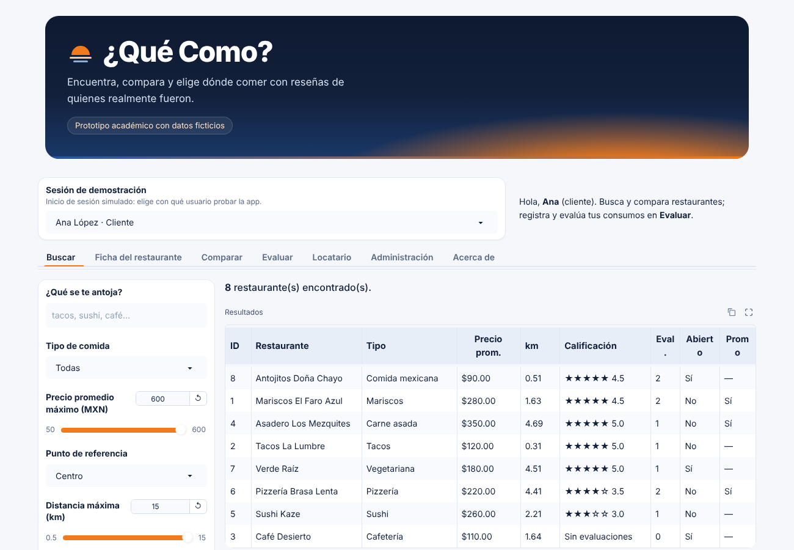
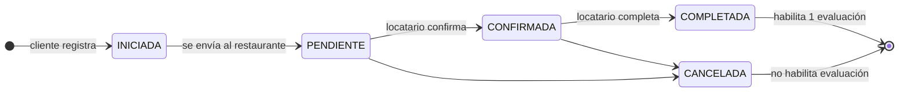
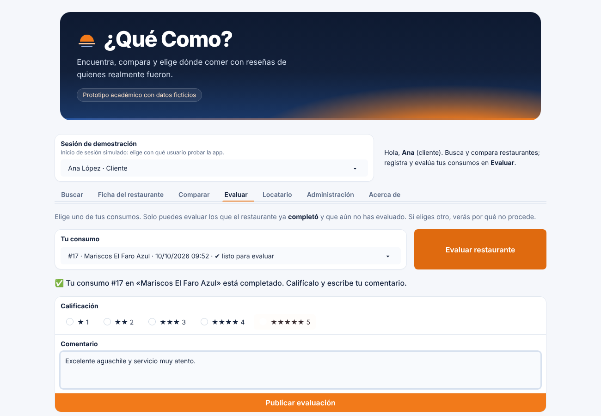
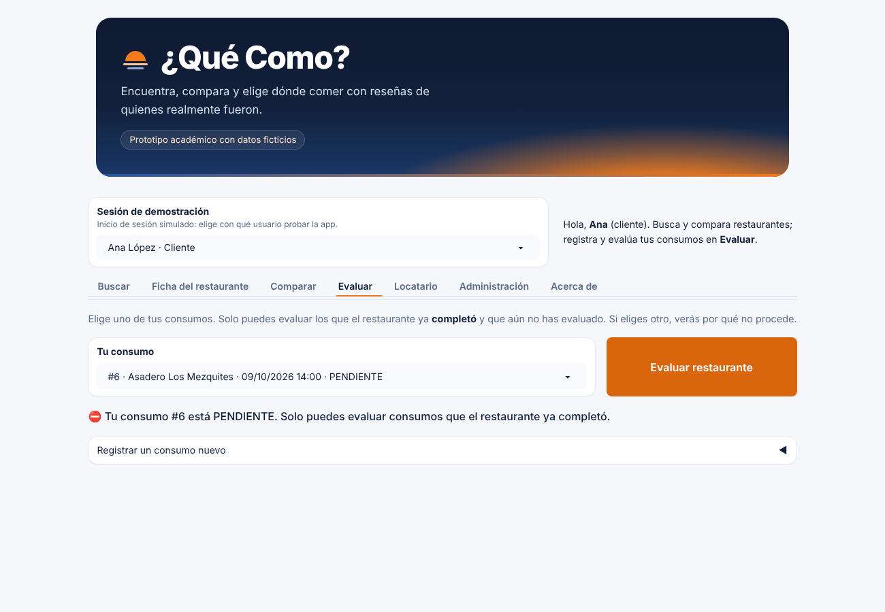
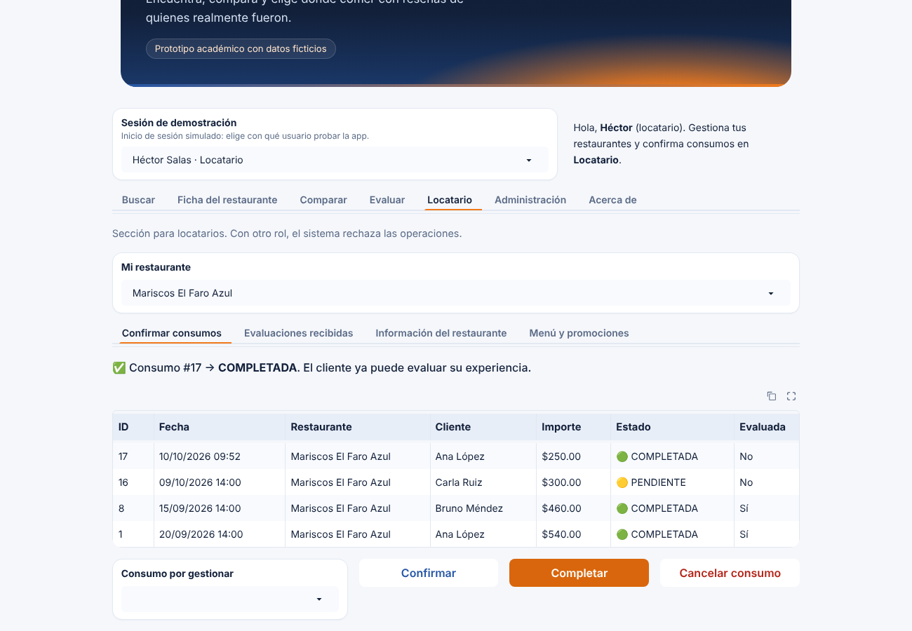
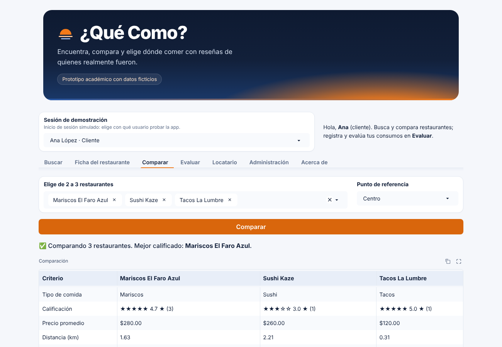
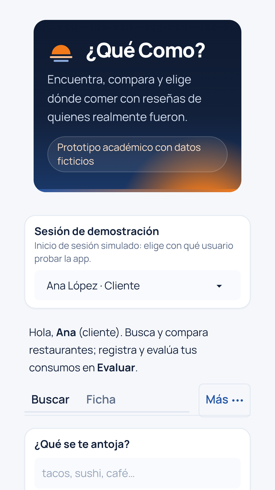
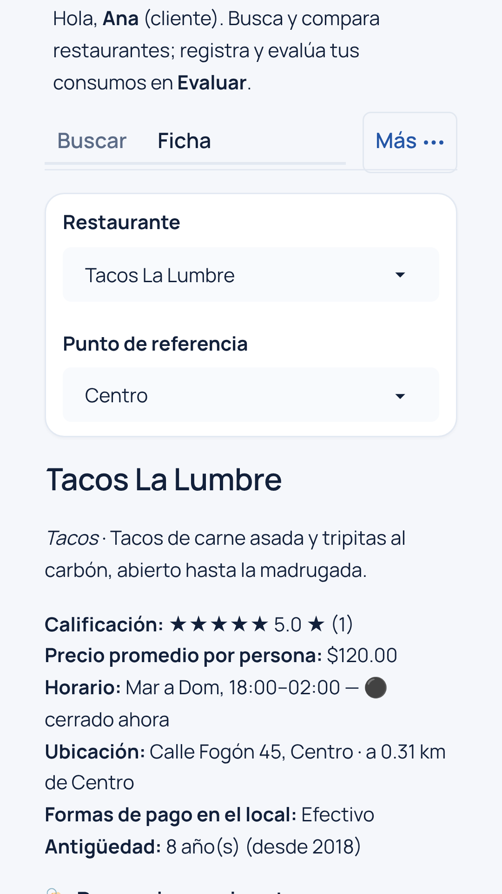
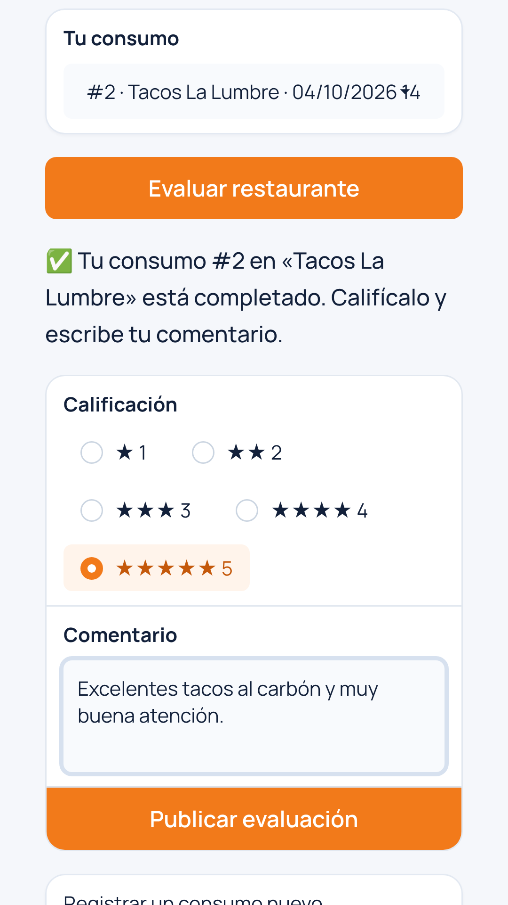
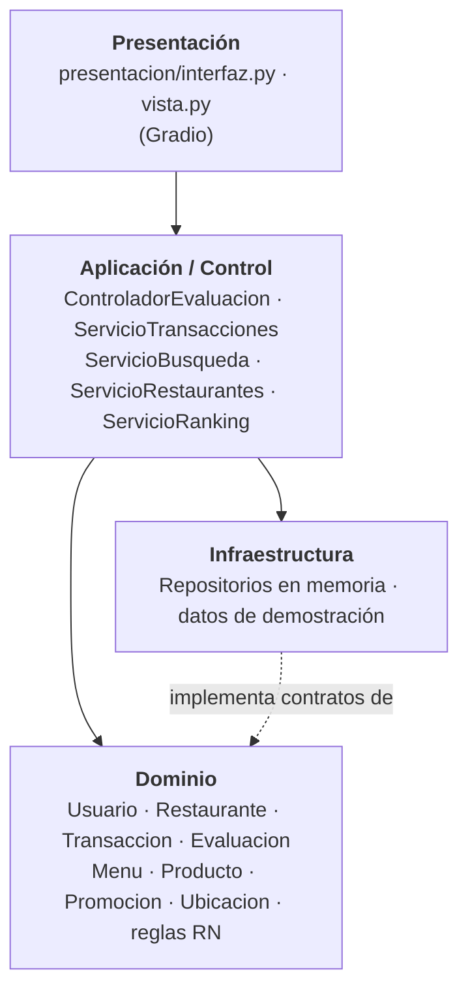

# 🍽️ ¿Qué Como?

> *Convertir la búsqueda de un restaurante en una decisión informada.*

**¿Qué Como?** es una plataforma web **y app para Android** para **descubrir, filtrar, comparar y evaluar restaurantes**. Su diferenciador es la **trazabilidad de las evaluaciones**: solo puede evaluar quien tiene una **transacción completada** con el restaurante, y cada transacción respalda **una sola** evaluación.

Este repositorio contiene el **MVP académico** desarrollado en Python con [Gradio](https://www.gradio.app/), construido a partir del *Documento Fundamental de Desarrollo* (Actividades 1–4 de Ingeniería de Software), incluido en [`docs/referencias/`](docs/referencias/).


> ℹ️ Sustituye `OWNER/REPO` en la insignia de pruebas por tu usuario y nombre de repositorio de GitHub.



---

## Contenido

- [Funcionalidades](#funcionalidades)
- [La regla de confianza](#la-regla-de-confianza)
- [Inicio rápido](#inicio-rápido)
- [Cómo probarla en 2 minutos](#cómo-probarla-en-2-minutos)
- [App para Android y Google Play](#app-para-android-y-google-play)
- [Arquitectura](#arquitectura)
- [Estructura del repositorio](#estructura-del-repositorio)
- [Pruebas](#pruebas)
- [Documentación](#documentación)
- [Limitaciones y riesgos conocidos](#limitaciones-y-riesgos-conocidos)
- [Hoja de ruta](#hoja-de-ruta)
- [Créditos y licencia](#créditos-y-licencia)

---

## Funcionalidades

| Pestaña | Qué permite | Historias |
|---|---|---|
| **Buscar** | Buscar por texto (incluye platillos del menú) y filtrar por tipo de comida, precio, distancia, horario, forma de pago en el local, calificación mínima y promociones. Ordenar por ranking, cercanía, precio o antigüedad. | HU-01, HU-02, HU-05 |
| **Ficha** | Descripción, horario, ubicación, formas de pago en el local, antigüedad, menú, promociones vigentes, distribución de calificaciones y evaluaciones verificadas. | HU-03, HU-05 |
| **Comparar** | Comparar de 2 a 3 restaurantes lado a lado en 11 criterios. | HU-04 |
| **Evaluar** | Caso de uso **CU-01**: elegir uno de tus consumos, validarlo y publicar la evaluación; muestra el motivo exacto cuando se rechaza. Incluye la sección plegable **Registrar un consumo nuevo**. | HU-06, HU-07, HU-08 |
| **Locatario** | Confirmar y completar consumos, consultar evaluaciones recibidas, registrar y editar el restaurante, agregar productos y promociones. | HU-09, HU-10, HU-11 |
| **Administración** | Suspender/activar restaurantes y moderar evaluaciones (con motivo obligatorio). | Rol Administrador |

## La regla de confianza



- **RN-01** Solo evalúa quien tiene una transacción válida con el restaurante.
- **RN-03** Toda evaluación queda vinculada a usuario, restaurante y transacción.
- **RN-04** Una evaluación nunca crea ni justifica una transacción.
- **RN-05** Una transacción cancelada o incompleta no habilita la evaluación.
- **RN-06** Una transacción respalda como máximo una evaluación.
- **RN-07** ¿Qué Como? **no ofrece ni procesa pagos en línea**: solo informa si el restaurante acepta efectivo o tarjeta en el local.
- **CA-08** El cliente **no** puede completar su propia transacción; el administrador **tampoco** puede fabricar esa evidencia. Solo el locatario dueño la confirma y completa.

La decisión `puede_evaluarse()` vive en la clase `Transaccion` (patrón GRASP *Information Expert*) y se aplica en `[estado == COMPLETADA AND noExisteEvaluacion]`.

## Inicio rápido

Requisitos: **Python 3.10 o superior** y Git.

```bash
# 1. Clonar el repositorio
git clone https://github.com/OWNER/REPO.git
cd REPO

# 2. Crear y activar un entorno virtual
python -m venv .venv
source .venv/bin/activate        # Windows: .venv\Scripts\activate

# 3. Instalar dependencias
pip install -r requirements.txt

# 4. Ejecutar
python app.py
```

Abre **http://127.0.0.1:7860** en el navegador.

Variables de entorno opcionales:

| Variable | Uso | Valor por defecto |
|---|---|---|
| `QUECOMO_ZONA_HORARIA` | Zona horaria para «abierto ahora» | `America/Hermosillo` |
| `GRADIO_SERVER_NAME` | Dirección de escucha (`0.0.0.0` para exponer en red) | `127.0.0.1` |
| `GRADIO_SERVER_PORT` | Puerto | `7860` |
| `PORT` | Puerto asignado por la nube (Render); activa `0.0.0.0` automáticamente | — |
| `QUECOMO_DATOS_POR_SESION` | `1`: cada visitante tiene su propia copia de los datos; `0`: todos comparten | `1` |
| `QUECOMO_ANDROID_PAQUETE` | Paquete de la app Android (para `assetlinks.json`) | `mx.quecomo.app` |
| `QUECOMO_ANDROID_SHA256` | Huella(s) SHA-256 del certificado de firma, separadas por comas | — |
| `QUECOMO_RESPONSABLE`, `QUECOMO_CORREO_CONTACTO`, `QUECOMO_DOMICILIO` | Datos del aviso de privacidad (`/privacidad`) | — |

## Cómo probarla en 2 minutos

La app incluye **datos ficticios** y un **inicio de sesión simulado** (selector «👤 Sesión de demostración»).

1. Como **Ana López (Cliente)**, abre **Evaluar**: su consumo en *Tacos La Lumbre* ya está listo para evaluar. Pulsa **Evaluar restaurante**, califica, comenta y pulsa **Publicar evaluación**.
2. Elige ahora una transacción **PENDIENTE**, **CANCELADA** o **ya evaluada**: el sistema la rechaza explicando por qué.
3. En **Evaluar → Registrar un consumo nuevo**, registra una visita a *Mariscos El Faro Azul*.
4. Cambia la sesión a **Héctor Salas (Locatario)**, ve a **Locatario → Confirmar consumos**, selecciona el consumo, pulsa **Confirmar** y luego **Completar**.
5. Vuelve a **Ana López**: la nueva transacción aparece como «✔ evaluable».

| Usuario de demostración | Rol | Para probar |
|---|---|---|
| Ana López, Bruno Méndez, Carla Ruiz | Cliente | Buscar, transacciones, evaluar |
| Héctor Salas, Elena Torres, Fernando Ibarra | Locatario | Gestionar restaurantes y transacciones |
| Gabriela Núñez | Administrador | Moderación |

### Capturas

| Evaluación (CU-01) | Rechazo con motivo |
|---|---|
|  |  |
| **Panel del locatario** | **Comparación** |
|  |  |

## App para Android y Google Play

La app de Android es una **Trusted Web Activity**: una app ligera que abre el sitio desplegado a pantalla completa con el motor de Chrome, verificada con *Digital Asset Links*. Las reglas de negocio siguen en el servidor y los cambios en Python llegan a la app sin publicar otra versión.

| Pieza | Dónde |
|---|---|
| Proyecto Android (`targetSdk 36`, AAB) | [`android/`](android/) |
| Rutas web para la app: manifiesto, service worker, `/.well-known/assetlinks.json`, `/privacidad`, `/salud` | [`servidor.py`](src/quecomo/presentacion/servidor.py) |
| Compilación del AAB firmado | [`.github/workflows/android.yml`](.github/workflows/android.yml) |
| Ícono, gráfico destacado, capturas y textos de la ficha | [`tienda/`](tienda/LEEME.md) |
| Guía paso a paso (firma, Play Console, prueba cerrada, seguridad de los datos) | [`docs/13`](docs/13_android_y_google_play.md) |

<p>



</p>

## Identidad visual

La interfaz usa la paleta **«atardecer en el desierto»**: azul noche del cielo y naranja del horizonte. El degradado solo aparece en el encabezado; el resto es sobrio para que destaque la información. Incluye modo oscuro automático. Los tokens están en [`src/quecomo/presentacion/tema.py`](src/quecomo/presentacion/tema.py).

| Token | Color | Uso |
|---|---|---|
| Noche | `#12203A` | Encabezado, títulos |
| Cobalto | `#2456A6` | Acciones secundarias, foco |
| Cielo | `#E8EEF8` | Superficies suaves, cabeceras de tabla |
| Atardecer | `#F27A1A` | Acción principal, pestaña activa |
| Brasa | `#C4580A` | Texto naranja sobre fondo claro |

En la interfaz se usa la palabra **«consumo»**; en el dominio y la documentación técnica, **«transacción»**. Son el mismo concepto.

## Arquitectura

Arquitectura en **cuatro capas** (sección 9 del Documento Fundamental). Las dependencias apuntan hacia el dominio; el dominio no conoce Gradio ni la persistencia.



Más detalle en [`docs/06_arquitectura.md`](docs/06_arquitectura.md).

## Estructura del repositorio

```
que-como/
├── app.py                         # Punto de entrada: python app.py
├── android/                       # App Android (Trusted Web Activity) para Google Play
├── tienda/                        # Recursos y textos de la ficha de Google Play
├── herramientas/                  # Scripts: íconos, capturas y gráfico de la tienda
├── src/quecomo/
│   ├── dominio/                   # Entidades, estados, excepciones, contratos de repositorio
│   ├── aplicacion/                # Controlador CU-01 y servicios de casos de uso
│   ├── infraestructura/           # Repositorios en memoria y datos de demostración
│   ├── presentacion/              # Interfaz Gradio, adaptador (vista.py), servidor.py y estaticos/
│   └── configuracion.py           # Raíz de composición: arma la aplicación
├── tests/                         # 146 pruebas (unitarias, integración, presentación y servidor)
├── docs/                          # Documentación de ingeniería, legal y de negocio
│   └── referencias/               # Documento Fundamental original (PDF)
├── .github/workflows/             # Pruebas (pruebas.yml) y compilación Android (android.yml)
├── render.yaml · .python-version  # Despliegue en Render
├── requirements.txt / requirements-dev.txt / pyproject.toml
└── CONTRIBUTING.md · CHANGELOG.md · LICENSE
```

## Pruebas

```bash
pip install -r requirements-dev.txt
pytest                                     # ejecutar todas
pytest --cov=quecomo --cov-report=term     # con cobertura
ruff check .                               # estilo
```

Las pruebas están trazadas a los criterios de aceptación (CA-01…CA-08) y reglas de negocio (RN-01…RN-06). Ver [`docs/09_pruebas.md`](docs/09_pruebas.md).

## Documentación

| Documento | Contenido |
|---|---|
| [01 · Visión y usuarios](docs/01_vision_y_usuarios.md) | Problema, propuesta, Vision Statement, actores, proto-personas, escenario |
| [02 · Historias y backlog](docs/02_historias_y_backlog.md) | HU-01…HU-12 con estado de implementación |
| [03 · Requisitos y reglas](docs/03_requisitos_y_reglas.md) | RF, RN, requisitos de calidad y dónde se implementan |
| [04 · Caso de uso CU-01](docs/04_caso_de_uso_CU01.md) | Flujo principal, extensiones y su realización en código |
| [05 · Modelo de dominio](docs/05_modelo_de_dominio.md) | Conceptos, asociaciones y diagrama de clases |
| [06 · Arquitectura](docs/06_arquitectura.md) | Capas, GRASP, decisiones de diseño |
| [07 · Diseño dinámico](docs/07_diseno_dinamico.md) | Diagrama de secuencia y máquina de estados |
| [08 · Trazabilidad](docs/08_trazabilidad.md) | Matriz problema → HU → RN → código → pruebas |
| [09 · Pruebas](docs/09_pruebas.md) | Estrategia y mapeo CA/RN → pruebas |
| [10 · Cumplimiento legal (preliminar)](docs/10_cumplimiento_legal.md) | Datos personales, licencias, riesgos (México) |
| [11 · Validación y modelo de negocio](docs/11_validacion_y_modelo_de_negocio.md) | Hipótesis, experimentos, métricas, riesgos |
| [12 · GitHub y despliegue](docs/12_guia_github_y_despliegue.md) | Subir el repositorio y publicar la demo (Render o Hugging Face) |
| [13 · Android y Google Play](docs/13_android_y_google_play.md) | App Android (TWA), firma, Play Console, prueba cerrada, seguridad de los datos |

## Limitaciones y riesgos conocidos

- **Inicio de sesión simulado.** No hay contraseñas ni autenticación real; el selector de usuario existe solo para la demostración.
- **Datos en memoria y por sesión.** Cada visitante trabaja con su propia copia de los datos de demostración; se borra al cerrar la app y al reiniciar el servidor. Los contratos de repositorio permiten cambiar a SQLite/PostgreSQL sin tocar el dominio.
- **Sin pagos en línea (decisión de producto).** La app no cobra ni ofrece transferencias o pasarelas: el pago ocurre en el restaurante y la transacción es solo el registro del consumo, que el restaurante confirma y completa manualmente.
- **Riesgo de diseño importante:** como el locatario decide si una transacción se completa, podría **no completar** las de clientes insatisfechos para evitar malas evaluaciones. Ver mitigaciones propuestas en [`docs/11_validacion_y_modelo_de_negocio.md`](docs/11_validacion_y_modelo_de_negocio.md#4-riesgo-crítico-el-locatario-controla-la-evidencia).
- **Uso no apto para producción** sin antes atender los pendientes de [`docs/10_cumplimiento_legal.md`](docs/10_cumplimiento_legal.md) (aviso de privacidad, términos de uso, autenticación, persistencia segura).

## Hoja de ruta

1. Persistencia con SQLite y migraciones.
2. Autenticación real y gestión de sesiones.
3. Mitigación del sesgo del locatario (confirmación automática con plazo, código de ticket, disputas).
4. Casos de uso restantes como documentos formales (búsqueda, comparación, registro de restaurante).
5. HU-12: evaluación del restaurante hacia el cliente (si la regla de negocio lo habilita).
6. Aviso de privacidad y términos de uso revisados profesionalmente.
7. Publicación en Google Play (prueba cerrada de 14 días) y prueba con usuarios reales.
8. App nativa (Kotlin) con API REST cuando existan cuentas y persistencia.

## Créditos y licencia

Proyecto académico de la materia de **Ingeniería de Software**.
Autores: **[Nombre(s) del equipo]** — *edita esta línea antes de publicar*.

Código bajo licencia **MIT** (ver [`LICENSE`](LICENSE)). Verifica que tu institución no establezca condiciones distintas sobre la titularidad de los trabajos académicos antes de publicar.

Todos los restaurantes, personas y evaluaciones de los datos de demostración son **ficticios**.
