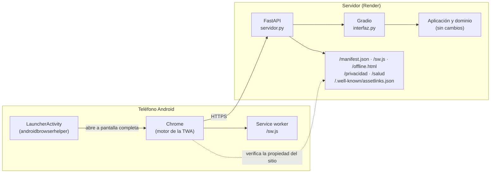

# 13 · App para Android y publicación en Google Play

> Requisitos de Google Play verificados el **10 de octubre de 2026** en las fuentes oficiales listadas al final. Las políticas cambian; revísalas antes de cada envío.

## 1. Objetivo y decisión técnica

Publicar ¿Qué Como? en Google Play **sin reescribir la aplicación**, conservando la arquitectura en capas, las 146 pruebas y las reglas de negocio en el servidor.

| Alternativa | Qué implica | Veredicto |
|---|---|---|
| **Trusted Web Activity (TWA)** | App Android mínima que abre el sitio desplegado a pantalla completa con el motor de Chrome. Google la mantiene (biblioteca `androidbrowserhelper`) y es la vía recomendada para publicar una PWA en Play. | ✅ **Elegida** |
| App nativa (Kotlin + Jetpack Compose) | Reescribir las 7 pantallas y exponer una API REST desde Python. Mejor experiencia sin conexión, pero semanas de trabajo y dos interfaces que mantener. | Hoja de ruta, cuando haya cuentas reales y persistencia |
| WebView propio / Capacitor | Similar a la TWA, pero con un navegador incrustado que hay que mantener actualizado y más riesgo de rechazo como «app que solo envuelve una web». | Descartada |

**Ventajas de la TWA para este proyecto**

- Las reglas de negocio (RN-01…RN-07, CA-08) siguen **solo en el servidor**; la app no duplica lógica.
- Cada cambio en la web llega a la app **sin publicar una versión nueva** en Play.
- La app no pide permisos, no guarda datos en el teléfono y pesa muy poco.

**Limitación:** necesita conexión a internet. Sin conexión muestra una pantalla propia que reintenta sola.

## 2. Arquitectura



**Verificación (Digital Asset Links).** La app declara «confío en `https://DOMINIO`» (`assetStatements`, en `android/app/build.gradle.kts`) y el sitio declara «confío en la app `mx.quecomo.app` firmada con la huella X» (`/.well-known/assetlinks.json`). Si las dos partes no coinciden, la app se abre **con barra de dirección** (como pestaña de Chrome): es la señal de que la configuración falla.

### Cambios hechos en el proyecto

| Archivo | Cambio |
|---|---|
| `src/quecomo/presentacion/servidor.py` | **Nuevo.** FastAPI con Gradio montado en `/` y las rutas que exige la app Android. Configurable con variables de entorno. |
| `src/quecomo/presentacion/estaticos/` | **Nuevo.** Service worker, página sin conexión, plantilla del aviso de privacidad e íconos. |
| `src/quecomo/presentacion/interfaz.py` | **Datos por sesión:** cada visitante trabaja con su propia copia de los datos de demostración (`gr.State`). Pestaña «Ficha» con nombre corto para que quepa en el teléfono. Enlace al aviso de privacidad. |
| `src/quecomo/presentacion/tema.py` | Ajustes móviles: sin desplazamiento horizontal, sesión en una columna, áreas táctiles de 44 px, menú «Más» visible. |
| `src/quecomo/configuracion.py` | `datos_por_sesion()` (variable `QUECOMO_DATOS_POR_SESION`). |
| `app.py` | Arranca el servidor con Uvicorn y respeta el HTTPS del proxy de Render. |
| `android/` | **Nuevo.** Proyecto Android (Gradle, AGP 8.13.2, `targetSdk 36`, `androidbrowserhelper 2.7.3`). |
| `.github/workflows/android.yml` | **Nuevo.** Compila el AAB firmado y lo deja como artefacto. |
| `.github/workflows/pruebas.yml` · `.python-version` | Restaurados (el README y Render ya los esperaban). |
| `tienda/` | Ícono 512, gráfico destacado, 6 capturas de teléfono y textos de la ficha. |
| `herramientas/` | Scripts que regeneran íconos, capturas y gráfico. |
| `tests/test_servidor.py` | 30 pruebas nuevas (rutas, assetlinks, privacidad, aislamiento entre sesiones). |

### ¿Por qué datos por sesión?

Antes, todas las personas compartían los mismos datos en memoria y cualquiera podía elegir al usuario «Administrador» y suspender restaurantes para todos. En una app pública eso permite que un desconocido altere lo que ven los demás y convierte las reseñas en **contenido generado por usuarios visible para terceros**, que Google Play obliga a moderar (política de contenido generado por usuarios). Con datos por sesión:

- Lo que una persona escribe **solo lo ve ella**, y se borra al cerrar la app o tras 6 horas sin cambios.
- Cada sesión ocupa ≈ 40 KB; se guardan como máximo 1 000 sesiones.
- Para demostrar en clase el flujo cliente → locatario entre **dos dispositivos**, define `QUECOMO_DATOS_POR_SESION=0` (no lo uses en la versión pública).

## 3. Requisitos vigentes de Google Play que afectan a este proyecto

| Requisito | Qué exige | Cómo se cumple |
|---|---|---|
| Nivel de API objetivo | Apps nuevas y actualizaciones: **Android 16 (API 36)** desde el 31/08/2026 | `targetSdk = 36` |
| Formato | Android App Bundle (`.aab`) | `./gradlew bundleRelease` / GitHub Actions |
| Firma | Play App Signing: tú firmas con una **llave de subida**; Google firma la versión final | Sección 4.2 |
| Prueba cerrada (cuentas **personales** creadas después del 13/11/2023) | **12 personas** inscritas durante **14 días seguidos** antes de pedir acceso a producción; Google revisa la solicitud (≈ 7 días) | Sección 4.7 |
| Política de privacidad | Obligatoria para el formulario de Seguridad de los datos, **aunque la app no recopile datos** | `https://DOMINIO/privacidad` |
| Seguridad de los datos | Formulario obligatorio | Sección 4.6 |
| Funcionalidad mínima | No se aceptan apps que solo muestran un sitio ajeno; el sitio debe ser tuyo y ofrecer una experiencia de app | Sitio propio, verificado con assetlinks, interfaz móvil y pantalla sin conexión |

## 4. Paso a paso

### 4.0 Decide dos datos permanentes

1. **Nombre del paquete** (por defecto `mx.quecomo.app`). Debe ser único en todo Google Play y **no se puede cambiar** después de la primera subida. Si no tienes el dominio `quecomo.mx`, una opción segura es `io.github.TU_USUARIO.quecomo`. Cámbialo en **tres lugares**: `android/gradle.properties` (`quecomo.applicationId`), `render.yaml` (`QUECOMO_ANDROID_PAQUETE`) y `PAQUETE_PREDETERMINADO` en `servidor.py`. La prueba `test_paquete_coincide_en_android_render_y_servidor` avisa si no coinciden.
2. **Dominio** del servidor (por defecto `que-como.onrender.com`): `quecomo.host` en `android/gradle.properties`. Si lo cambias después, hay que publicar una nueva versión de la app.

### 4.1 Despliega el servidor actualizado

1. Sube los cambios a GitHub. Render vuelve a desplegar (el comando de inicio sigue siendo `python app.py`).
2. En Render → *Environment*, define:

| Variable | Ejemplo |
|---|---|
| `QUECOMO_RESPONSABLE` | Nombre de la persona o equipo responsable |
| `QUECOMO_CORREO_CONTACTO` | correo@ejemplo.com |
| `QUECOMO_DOMICILIO` | Hermosillo, Sonora, México |
| `QUECOMO_ANDROID_SHA256` | *(se llena en el paso 4.5)* |

3. Comprueba en el navegador: `https://DOMINIO/salud`, `/manifest.json`, `/privacidad` (sin textos «pendiente»).

> **Plan de Render.** En el plan gratuito el servidor se suspende tras unos minutos sin uso y la siguiente apertura tarda cerca de un minuto (la app muestra «Conectando…» y reintenta sola). Para la revisión de Google y para usuarios reales usa un plan que no se suspenda; un revisor que ve una pantalla de espera larga puede rechazar la app.

### 4.2 Crea la llave de subida (una sola vez)

```bash
keytool -genkeypair -v -keystore quecomo-subida.jks -alias quecomo \
        -keyalg RSA -keysize 2048 -validity 10000
```

- Guarda el `.jks` y sus contraseñas en un lugar seguro **fuera del repositorio** (el `.gitignore` ya excluye `*.jks`). Si la pierdes, Google permite restablecer la llave de subida desde Play Console, pero tarda.
- Para GitHub Actions, en *Settings → Secrets and variables → Actions* crea:

| Secreto | Valor |
|---|---|
| `ANDROID_KEYSTORE_BASE64` | salida de `base64 -w0 quecomo-subida.jks` (macOS: `base64 -i quecomo-subida.jks`) |
| `ANDROID_KEYSTORE_PASSWORD` | contraseña del almacén |
| `ANDROID_KEY_ALIAS` | `quecomo` |
| `ANDROID_KEY_PASSWORD` | contraseña de la llave |

### 4.3 Compila el AAB

**Opción A — GitHub Actions (no requiere instalar nada):** *Actions → Android → Run workflow*, escribe la versión (p. ej. `1.0.0`). Descarga el artefacto `quecomo-android-N` (contiene el `.aab` y un `.apk`). El resumen de la ejecución muestra la huella SHA-256 de tu llave de subida. El `versionCode` es el número de ejecución, así que siempre aumenta.

**Opción B — Android Studio:** abre la carpeta `android/`, espera la sincronización de Gradle y usa *Build → Generate Signed App Bundle*.

**Opción C — terminal** (JDK 17 y Android SDK instalados):

```bash
cd android
export QUECOMO_KEYSTORE=/ruta/quecomo-subida.jks QUECOMO_KEYSTORE_PASSWORD=... \
       QUECOMO_KEY_ALIAS=quecomo QUECOMO_KEY_PASSWORD=...
./gradlew bundleRelease -Pquecomo.versionCode=2 -Pquecomo.versionName=1.0.1
# Resultado: app/build/outputs/bundle/release/app-release.aab
```

### 4.4 Crea la app en Play Console

1. Cuenta de desarrollador de Google Play (pago único de registro y verificación de identidad).
2. *Crear app*: nombre «¿Qué Como? – Restaurantes», idioma predeterminado **Español (Latinoamérica) – es-419**, tipo **App**, **Gratis**.
3. *Prueba y lanzamiento → Pruebas → Prueba interna*: crea una versión, acepta **Play App Signing** y sube el `.aab`.

### 4.5 Conecta la app con el sitio (assetlinks)

1. En Play Console → *Prueba y lanzamiento → Configuración → Integridad de la app → Firma de apps*, copia el **certificado SHA-256 de la llave de firma de apps** (es la llave de Google, distinta de la tuya).
2. En Render, define `QUECOMO_ANDROID_SHA256` con esa huella **y** la de tu llave de subida, separadas por coma (así funcionan tanto la versión de Play como un APK que instales tú):
   ```
   AB:CD:...:EF,12:34:...:90
   ```
3. Comprueba: `https://DOMINIO/.well-known/assetlinks.json` debe mostrar el paquete y las huellas. La herramienta de Google lo confirma:
   `https://digitalassetlinks.googleapis.com/v1/statements:list?source.web.site=https://DOMINIO&relation=delegate_permission/common.handle_all_urls`
4. Instala la app desde el enlace de **prueba interna** en un teléfono: **no debe verse la barra de dirección**. Si se ve, revisa paquete, huellas y dominio.

Un valor mal escrito en `QUECOMO_ANDROID_SHA256` o `QUECOMO_ANDROID_PAQUETE` detiene el servidor al iniciar con un mensaje claro en el log, en lugar de fallar en silencio.

### 4.6 Completa «Contenido de la app»

| Sección | Respuesta sugerida | Motivo |
|---|---|---|
| Política de privacidad | `https://DOMINIO/privacidad` | Obligatoria |
| Anuncios | No contiene anuncios | — |
| Acceso a la app | Toda la funcionalidad está disponible sin credenciales | No hay inicio de sesión real; explica el selector «Sesión de demostración» |
| Clasificación de contenido | Cuestionario IARC; categoría general. Interacción entre usuarios: **No** | Las reseñas no son visibles para otras personas (datos por sesión) |
| Público objetivo | **18 años o más** | Evita las obligaciones adicionales del programa para familias en un prototipo |
| App de noticias / gubernamental / funciones financieras / salud | No | — |
| Seguridad de los datos | Ver tabla siguiente | — |

**Seguridad de los datos (propuesta conservadora).** El formulario pregunta por datos que *salen del teléfono*. Lo que la persona escribe se envía al servidor y se guarda en memoria durante su sesión, por lo que no encaja del todo en la excepción de «procesamiento efímero» (que exige conservar los datos solo lo necesario para atender una solicitud en tiempo real). Por eso se recomienda declararlo:

| Tipo de dato | ¿Recopilado? | ¿Compartido? | Detalles |
|---|---|---|---|
| Otro contenido generado por el usuario (reseñas, comentarios) | Sí | No | Opcional · Funcionalidad de la app · No vinculado a identidad |
| Historial de compras (importe de los consumos de prueba) | Sí | No | Opcional · Funcionalidad de la app |
| Ubicación, contactos, identificadores, fotos | No | No | La app no los solicita |

Además: datos **cifrados en tránsito** (HTTPS) → Sí. Mecanismo para solicitar eliminación → los datos se eliminan automáticamente al terminar la sesión; indica el correo de contacto. Los registros técnicos del proveedor de alojamiento (IP) son una zona gris en la guía de Google: decide con tu equipo si declararlos y mantén coherencia con el aviso de privacidad. *Esta tabla es una recomendación técnica, no una opinión jurídica.*

### 4.7 Ficha de la tienda y prueba cerrada

1. *Ficha principal de Play Store*: usa los textos y archivos de [`tienda/`](../tienda/LEEME.md).
2. *Prueba cerrada*: crea una lista con al menos **12 cuentas de Google** (compañeros, familia), compárteles el enlace de inscripción y pídeles que **no se salgan durante 14 días seguidos** y que usen la app. Recoge sus comentarios: sirven como evidencia para la solicitud.
3. Pasados los 14 días, *Panel → Solicitar acceso a producción* y responde el cuestionario (prueba cerrada, app y preparación para producción).
4. Con la aprobación, publica en producción (empieza con un lanzamiento gradual, p. ej. 20 %).

### 4.8 Actualizaciones

| Tipo de cambio | Qué hacer |
|---|---|
| Interfaz, reglas, datos (todo lo de Python) | Solo desplegar en Render. **No** hace falta nueva versión en Play. |
| Ícono, nombre, colores, dominio, `targetSdk`, versión de `androidbrowserhelper` | Nueva compilación (versionCode mayor) y subirla a Play. |
| Requisito anual de nivel de API | Cada agosto Google sube el mínimo; actualiza `compileSdk`/`targetSdk` y AGP. |

## 5. Pruebas y criterios de aceptación

| ID | Criterio | Evidencia |
|---|---|---|
| AND-01 | El sitio sirve manifiesto, íconos, service worker, página sin conexión y aviso de privacidad | `tests/test_servidor.py` (automatizado) |
| AND-02 | `assetlinks.json` contiene el paquete y las huellas; valores mal formados detienen el arranque | `test_assetlinks_*`, `test_huella_invalida_*` |
| AND-03 | El paquete coincide en Android, Render y servidor | `test_paquete_coincide_en_android_render_y_servidor` |
| AND-04 | Lo que registra una sesión no lo ve otra | `test_lo_que_registra_una_sesion_no_lo_ve_otra` + prueba E2E en navegador |
| AND-05 | En un teléfono de 360 px no hay desplazamiento horizontal | Prueba E2E con Chromium móvil (ancho de página = 360 px) |
| AND-06 | Sin conexión aparece «Conectando con ¿Qué Como?» y, al volver la red, la app se recarga sola | Prueba E2E con Chromium (modo sin conexión) |
| AND-07 | El AAB compila con `targetSdk 36` | Flujo «Android» de GitHub Actions |
| AND-08 | La app instalada desde Play abre **sin** barra de dirección | Manual, en teléfono real (prueba interna) |
| AND-09 | La app funciona en Android 7 (API 24) y en una versión reciente | Manual, en emulador o teléfonos reales |

Los criterios AND-07 a AND-09 requieren el SDK de Android o un teléfono; ejecútalos antes de enviar a revisión.

## 6. Riesgos y mitigación

| Riesgo | Impacto | Mitigación |
|---|---|---|
| Huella o paquete incorrectos en assetlinks | La app muestra barra de dirección; posible rechazo | Validación al iniciar, prueba de consistencia, herramienta de Google (4.5) |
| Servidor suspendido (plan gratuito) | Primera apertura lenta; mala impresión en la revisión | Plan sin suspensión; pantalla «Conectando…» con reintento |
| Rechazo por «funcionalidad mínima» / web envuelta | No se publica | Sitio propio verificado, interfaz adaptada al teléfono, pantalla sin conexión; describir con claridad qué ofrece la app |
| Metadatos engañosos (datos ficticios presentados como reales) | Rechazo por política de metadatos | Ficha, encabezado y aviso dicen «prototipo con datos ficticios» |
| Pérdida de la llave de subida | No se pueden publicar actualizaciones hasta restablecerla | Respaldo cifrado del `.jks`; Play App Signing permite restablecerla |
| Aviso de privacidad con datos «pendiente» | Rechazo; incumplimiento | Configurar las tres variables (4.1) y revisar la página antes de enviar |
| Cambios de Gradio rompen los ajustes de CSS móvil | Interfaz desordenada en el teléfono | Versión acotada `gradio<7`; repetir la prueba E2E móvil al actualizar |
| Requisito anual de API objetivo | La app deja de poder actualizarse | Recordatorio cada agosto (sección 4.8) |

## 7. Lista de verificación antes de enviar a revisión

- [ ] Nombre de paquete definitivo en los tres lugares.
- [ ] `quecomo.host` apunta al dominio real.
- [ ] Render con plan sin suspensión y las variables del aviso de privacidad.
- [ ] `/privacidad` sin textos «pendiente».
- [ ] `assetlinks.json` con la huella de **firma de apps** de Play (y la de subida).
- [ ] App de prueba interna abre sin barra de dirección.
- [ ] Ficha: textos, ícono, gráfico y capturas.
- [ ] Contenido de la app: privacidad, anuncios, acceso, clasificación, público objetivo, seguridad de los datos.
- [ ] 12 personas en prueba cerrada durante 14 días.
- [ ] Revisión del aviso de privacidad por un profesional si la app va a operar con usuarios reales (ver [10](10_cumplimiento_legal.md)).

## Fuentes (consultadas el 10/10/2026)

- Android Developers — Requisito de nivel de API objetivo: <https://developer.android.com/google/play/requirements/target-sdk>
- Ayuda de Play Console — Requisitos de prueba para cuentas personales nuevas: <https://support.google.com/googleplay/android-developer/answer/14151465>
- Ayuda de Play Console — Sección de Seguridad de los datos: <https://support.google.com/googleplay/android-developer/answer/10787469>
- Chrome for Developers — Trusted Web Activities, guía de inicio: <https://developer.chrome.com/docs/android/trusted-web-activity/quick-start>
- Android Gradle Plugin 8.13 (compatibilidad): <https://developer.android.com/build/releases/agp-8-13-0-release-notes>
- `android-browser-helper` (versiones): <https://github.com/GoogleChrome/android-browser-helper/releases>
- Plantilla de Bubblewrap (referencia de la configuración TWA): <https://github.com/GoogleChromeLabs/bubblewrap>
